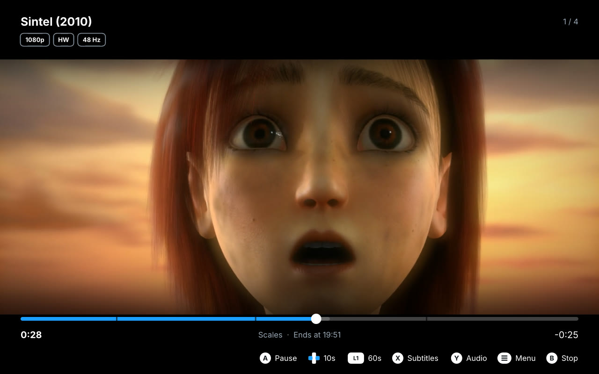
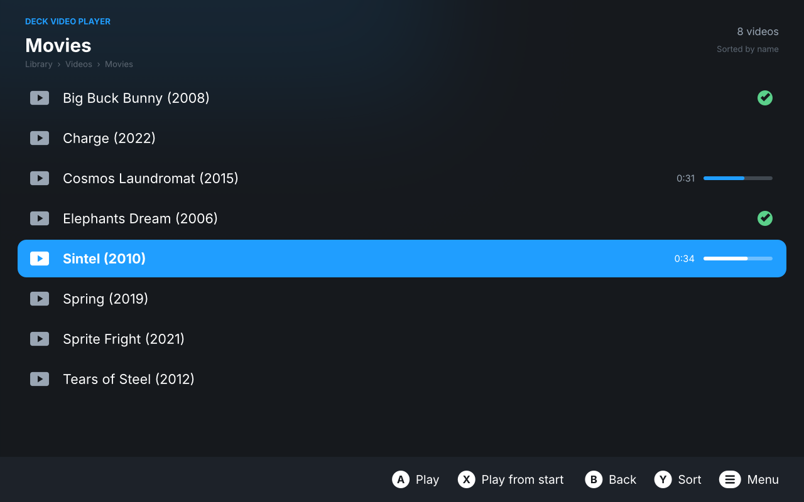
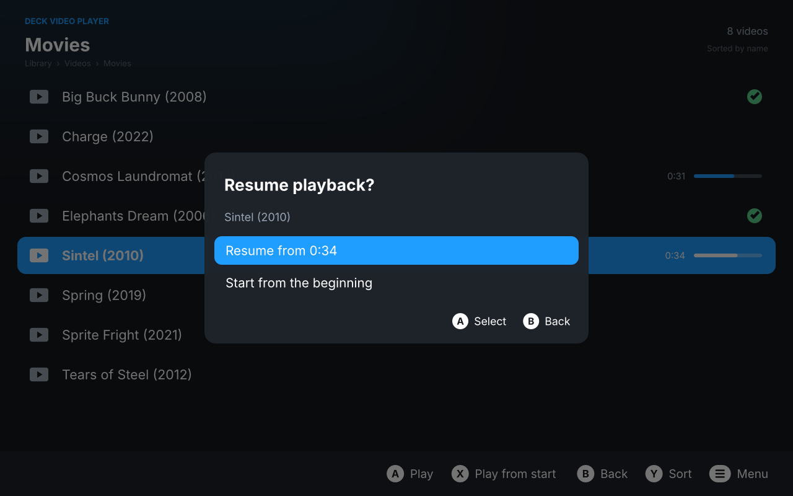
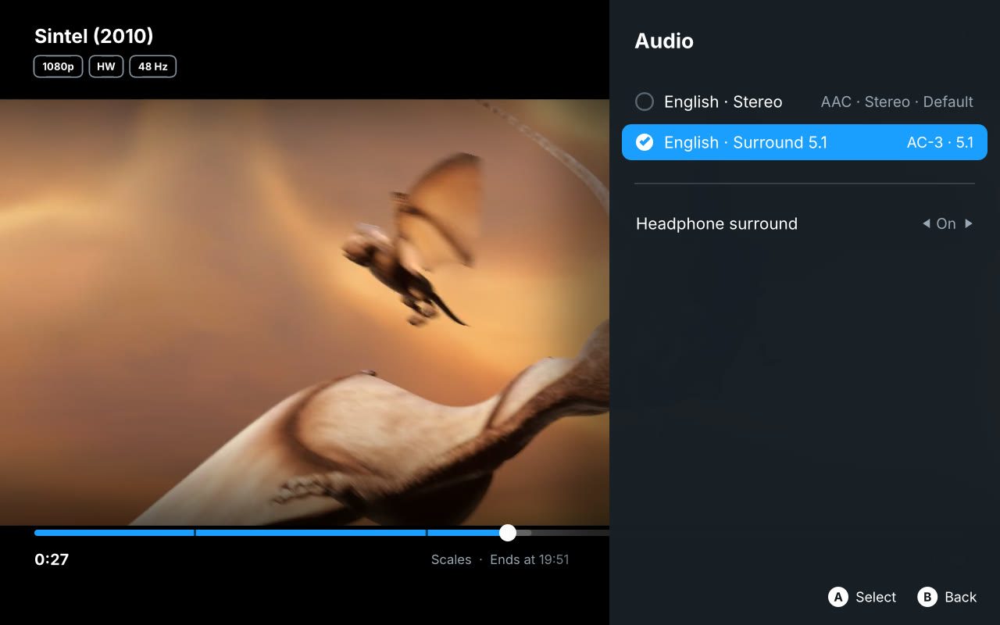
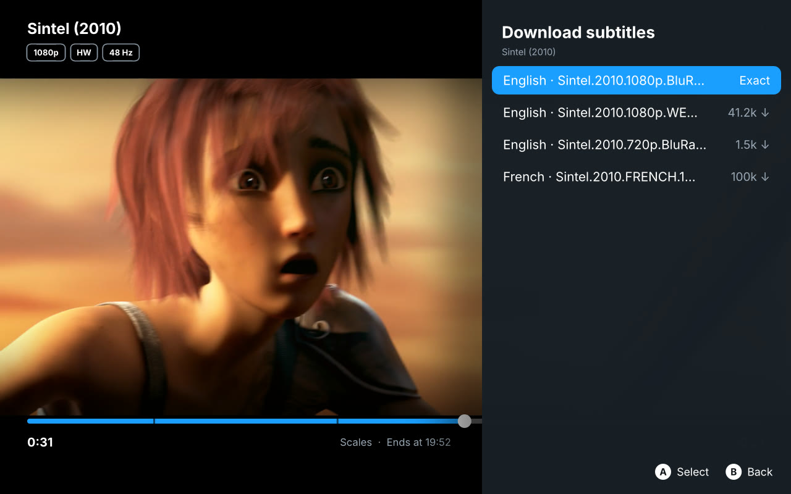
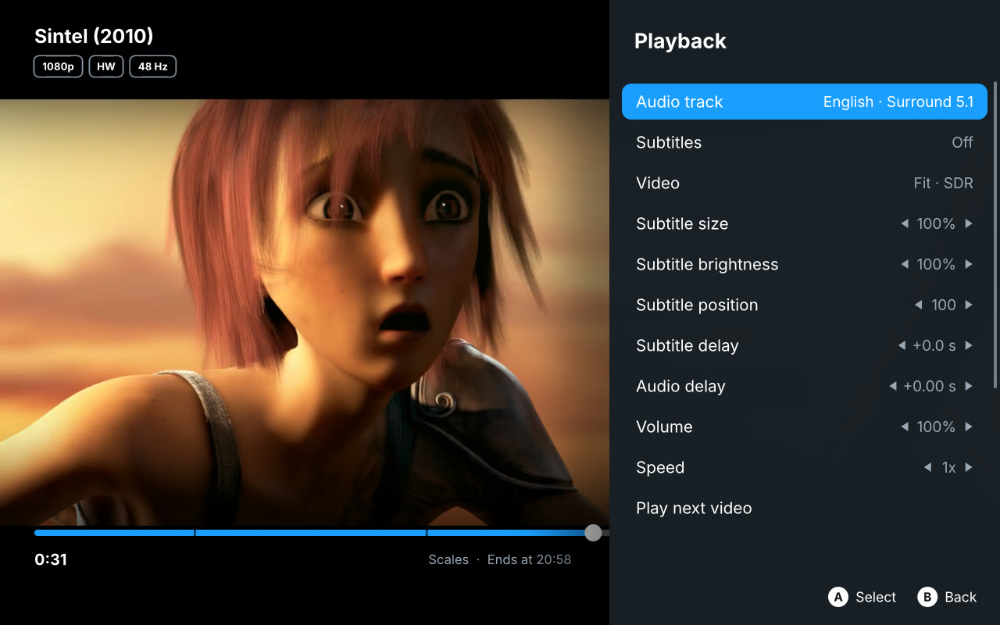
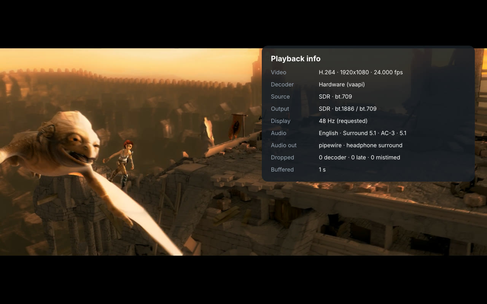

# Deck Video Player

A lightweight, controller-driven video player for the **Steam Deck** and
**SteamOS game mode** (and DIY Steam Machines). It is a thin front end for
[mpv](https://mpv.io): the whole interface (library browser, playback
controls, menus) is drawn by Lua scripts on mpv's own on-screen display, so
there is a single process and nothing between the video and the screen.

> [!WARNING]
> **Beta software.** Deck Video Player is, at best, beta quality. The
> developer has lightly tested it in SteamOS game mode on a **Steam Deck
> OLED**, a **Steam Deck LCD** and a **DIY Steam Machine** (a PC running
> official SteamOS, with a 4K HDR VRR TV). That is informal testing on a
> few devices, not a guarantee that it works on yours; other handhelds and
> desktop Linux are untested. Expect bugs, and please [report them](https://github.com/nicocarbone/DeckVideoPlayer/issues).
> The installer edits Steam's `shortcuts.vdf` (it keeps a `.bak` copy).
> Provided **without any warranty**, as described in the GPL (`LICENSE`).

- Plays essentially every format (FFmpeg), with **hardware decoding** through
  VA-API on the Deck's AMD APU (H.264, HEVC 8/10-bit, VP9, AV1).
- **Real HDR** in game mode: HDR10/HLG videos go to gamescope as HDR10
  (`VK_COLOR_SPACE_HDR10_ST2084_EXT`) with their metadata; SDR stays SDR.
- **Refresh-rate matching** on the Steam Deck: 24 fps films switch the panel
  to 48 Hz (or 72 Hz), 25 fps to 50 Hz, 30/60 fps to 60/90 Hz, then back.
- Full **controller** control, with a UI designed for 1280×800 that scales
  to 4K TVs.
- Audio / subtitle track selection, subtitle size/position/delay, audio
  delay, picture modes (including cropping black bars stored in the video),
  playback info panel.
- **Resume playback** per file, watched markers, recently played list,
  auto-play next video in the folder.
- **Headphone surround**: 5.1/7.1 soundtracks as 3D sound on headphones
  (toggle in the audio menu).
- **About** panel (library and playback menus) with version, build,
  licence and credits.
- **Plex**: sign in with a code, browse your Plex servers next to your
  folders (Continue watching, movies, shows), play the original files with
  HDR and hardware decoding, and keep progress in sync with your other Plex
  apps. Local network, and remote when your server allows it.
- **Download subtitles** from OpenSubtitles.com from the subtitle menu
  (needs your own free API key in `config.ini`: see
  [docs/INSTALL.md](docs/INSTALL.md#online-subtitles-opensubtitles)).

## Screenshots



| | |
|---|---|
|  |  |
| Library with watched marks and progress | Resume where you left off |
|  |  |
| Audio tracks and headphone surround | Subtitle download |
|  |  |
| Playback menu | Playback info (View button) |

Taken at the Steam Deck's 1280×800 in gamescope (headless), with the Deck
OLED profile. Video: *Sintel* trailer, © Blender Foundation,
[durian.blender.org](https://durian.blender.org), licensed
[CC BY 3.0](https://creativecommons.org/licenses/by/3.0/). The other titles
in the library are Blender open movies used as sample file names, and the
subtitle results come from the project's local test server
(`tools/mock-opensubtitles.py`), not from OpenSubtitles.

## Why another video player?

The Steam Deck can already play video, so this needs explaining. The gap
is **Game Mode**: watching your own files from the couch with the
controller, at the panel's full quality (HDR, the right refresh rate), with
no Desktop Mode detour and no media server. When this project started
(October 2026) we could not find a player that did all of that. Here is
what exists and where it falls short. Corrections are welcome.

- **[Kodi](https://kodi.tv)** is the closest alternative, and it does far
  more than this app: library scraping, posters, add-ons, SMB/NFS,
  Plex/Jellyfin add-ons. It runs in Game Mode and its interface is made for
  controllers. A November 2025 report from Game Mode on a Deck found that
  HDR is not detected, hardware decoding is not enabled out of the box, and
  Kodi cannot stop the dimming/sleep timers during playback
  ([xbmc#27490][kodi-issue]). Kodi 22 (in beta) adds HDR on Wayland
  ([9to5Linux][kodi22]), but Game Mode apps run on gamescope's Xwayland, so
  whether that reaches the Deck is untested. **If you don't need HDR, Kodi
  is a mature choice with many more features.**
- **[Plex HTPC](https://flathub.org/apps/tv.plex.PlexHTPC) and
  [Jellyfin Desktop](https://github.com/jellyfin/jellyfin-desktop)** are
  controller-friendly, mpv-based and run in Game Mode, but they need a
  media server running somewhere. We could not confirm HDR output on Linux
  in an official release of either. Jellyfin's HDR request is still open:
  HDR worked in an experimental rewrite that was abandoned in August 2026
  ([jellyfin-desktop#523][jmp-hdr]). If you already run one of those
  servers, compare with its client: Deck Video Player also plays from Plex
  since v0.3, as direct play only (no transcoding).
- **[mpv](https://mpv.io)** itself (Flathub `io.mpv.Mpv`) is the engine
  this app uses, and it can output real HDR in Game Mode with the right
  settings (Vulkan, `gpu-next`, gamescope's WSI layer; see the
  [LevelUpTalk guide][mpv-guide] or [DECISIONS D5](docs/DECISIONS.md)).
  But it has no file browser, and the Flathub build has no gamepad support
  (you would map the controller to keys with Steam Input), so it takes
  manual setup. This app is, in effect, that setup done for you plus a
  controller interface.
- **VLC, Haruna, Celluloid, SMPlayer** are good Desktop Mode players.
  Their interfaces need a mouse or the touchscreen, and we found no
  reports of them outputting HDR in Game Mode.
- **[240-MP](https://github.com/anthonycaccese/240-MP)** is an mpv-based
  player for the Deck with gamepad controls, built around a retro VCR look
  rather than a library browser.

What Deck Video Player adds is deliberately narrow:
- a controller-first library for local folders and the SD card;
- real HDR10 output through gamescope and VA-API hardware decoding;
- refresh-rate matching (48 Hz for 24 fps films and so on), which none of
  the players above document doing in Game Mode;
- resume, headphone surround, subtitle downloads;
- a Steam shortcut with artwork.

All of it needs no server and no setup beyond choosing a folder. It is
**not** a media center: there is no metadata scraping or posters, and no
network shares yet.

Our own caveats:
- Refresh-rate matching is confirmed on a Steam Deck OLED. On TVs the app
  doesn't switch modes (gamescope only retunes the Deck's own screen); a
  120 Hz mode already suits 24/30/60 fps, and VRR covers the rest.
- Players in Game Mode have been reported to be interrupted by the Deck's
  dim/sleep timers even when they ask the system to stay awake
  ([SteamOS#2619][sleep-issue]). Whether this app is affected is still
  being checked. Decky plugins such as
  [ScreenSaverEnhancements][sse] work around it.

[kodi-issue]: https://github.com/xbmc/xbmc/issues/27490
[kodi22]: https://9to5linux.com/kodi-22-piers-promises-hdr-passthrough-on-opengl-and-hdr-on-wayland
[jmp-hdr]: https://github.com/jellyfin/jellyfin-desktop/issues/523
[mpv-guide]: https://leveluptalk.com/news/watch-hdr-content-steam-deck-oled-guide/
[sleep-issue]: https://github.com/ValveSoftware/SteamOS/issues/2619
[sse]: https://github.com/Grails125/ScreenSaverEnhancements

## Documentation

| Document | Contents |
|---|---|
| [docs/INSTALL.md](docs/INSTALL.md) | Installation, Steam settings, usage, troubleshooting |
| [docs/CONFIGURATION.md](docs/CONFIGURATION.md) | Every `config.ini` setting |
| [docs/ARCHITECTURE.md](docs/ARCHITECTURE.md) | How it works: process model, UI, HDR, refresh rate, battery |
| [docs/DECISIONS.md](docs/DECISIONS.md) | Decision log with alternatives and reasons |
| [docs/CODE_REFERENCE.md](docs/CODE_REFERENCE.md) | Every source file and module API |
| [docs/DEVELOPMENT.md](docs/DEVELOPMENT.md) | Dev setup, unit/headless/Flatpak/on-device testing, building, releasing, recipes |
| [CHANGELOG.md](CHANGELOG.md) | What changed in each release |
| [docs/ROADMAP.md](docs/ROADMAP.md) | Releases and plans (later Jellyfin, network shares) and guiding rules |
| [AGENTS.md](AGENTS.md) | Quick orientation for AI agents and new contributors |
| [THIRD_PARTY_NOTICES.md](THIRD_PARTY_NOTICES.md) | Licences of bundled components, source availability, trademarks |

## Install on SteamOS

1. Switch to **Desktop Mode**, download the release archive
   (`DeckVideoPlayer-vX.Y.Z.tar.gz`) and extract it.
2. Open Konsole in the extracted folder and run:

   ```sh
   ./scripts/install-steamos.sh
   ```

   This installs everything per-user (nothing on SteamOS's read-only system
   partition, so it survives updates):
   - the app Flatpak (and the Freedesktop runtime from Flathub),
   - the gamescope Vulkan layer extension needed for HDR,
   - `~/.config/deckvideoplayer/config.ini`,
   - a **Non-Steam game** shortcut with library artwork.

3. Edit `~/.config/deckvideoplayer/config.ini` and set your video folders
   (`folder = ...`, one line per folder). The microSD card and USB drives
   are listed automatically. The app can read `~/Videos`, `~/Downloads`,
   removable drives and `/mnt`; other folders need one `flatpak override`
   command ([INSTALL](docs/INSTALL.md#troubleshooting)).
4. Return to **Gaming Mode** and start *Deck Video Player* from the library.

For HDR enable *Settings → Display → HDR* (Steam Deck OLED or HDR TV). On an
external 4K screen set the shortcut's *Properties → Game Resolution* to
**Native**, otherwise gamescope renders the app at 1280×800 and upscales it.

Uninstall with `./scripts/install-steamos.sh --uninstall`.

## Controls

| Button | Library | Playback |
| --- | --- | --- |
| **A** | Open folder / play | Play / pause |
| **B** | Back (quit at top level) | Hide the controls; with nothing on screen, stop and go back to the library |
| **X** | Play from the beginning | Subtitles menu |
| **Y** | Sort by name / date | Audio menu |
| **D-pad ↑ ↓** | Move | Volume |
| **D-pad ← →** | Page | Seek ±10 s |
| **L1 / R1** | Page | Seek ±60 s |
| **L2 / R2** | First / last item | Previous / next chapter |
| **View** | — | Playback info (decoder, HDR, refresh) |
| **Menu** | Library menu | Playback menu (tracks, subtitle size and delay, audio delay, speed, zoom…) |

A keyboard also works (arrows, Enter, Esc/Backspace, `x`, `y`, `m`, `i`,
PgUp/PgDn, Home/End).

## Configuration

`~/.config/deckvideoplayer/config.ini` is commented and covers library
folders, preferred audio/subtitle languages, subtitle behaviour, resume,
seek steps, audio passthrough (for AV receivers), hardware decoding, device
profile, rendering quality, HDR, refresh-rate matching and UI scale.

Advanced mpv options can be added to `~/.config/deckvideoplayer/mpv.conf`
(loaded after the app's own settings).

## How it works

```
Steam (game mode) ─ launches ─▶ flatpak run … deckvideoplayer (launcher script)
                                    │
                                    ▼
                              mpv --idle --force-window --config-dir=/app/share/deckvideoplayer/mpv
                                 │  vo=gpu-next, Vulkan, hwdec=vaapi
                                 │  target-colorspace-hint=yes
                                 │
                                 ├─ scripts/deckplayer/  (Lua UI: browser, player overlay, menus,
                                 │                        resume, refresh-rate matching)
                                 ▼
                     gamescope WSI layer ─▶ gamescope ─▶ panel / TV (SDR, HDR10, VRR)
```

- **Why mpv draws everything:** gamescope gives HDR only to apps that
  present through Vulkan with an HDR colorspace. Embedding mpv in a toolkit
  (libmpv's render API) is limited to OpenGL, which loses HDR passthrough.
  Letting mpv own the window and drawing the UI as OSD keeps HDR, zero-copy
  hardware decoding and the lowest possible overhead. No timers run while
  the overlay is hidden.
- **HDR:** under gamescope the launcher selects `--gpu-context=x11vk`; the
  gamescope WSI layer (Flatpak extension
  `org.freedesktop.Platform.VulkanLayer.gamescope`) exposes HDR10 swapchain
  formats and mpv switches to them for HDR content.
- **Refresh-rate matching:** asks gamescope for a multiple of the video's
  frame rate through the same control protocol Steam's refresh slider uses
  (small helper `dvp-gamescope-refresh`), choosing from the rates gamescope
  reports for the panel, then checks that the switch really happened and
  restores the previous rate afterwards. VRR displays don't need it:
  gamescope follows mpv's frame pacing.
- **Battery:** VA-API decoding with dmabuf import into Vulkan (no copies),
  `video-sync=audio` without interpolation, the "balanced" rendering profile
  on the Deck (cheap downscaling, no HDR peak detection). `quality = battery`
  goes further; Steam Machines default to mpv's `high-quality` profile.
- **Why a custom Flatpak:** Flathub's mpv is built without SDL2 gamepad
  support, which the controller input relies on. The manifest builds mpv
  0.41 (LuaJIT, SDL2 gamepad, Vulkan, VA-API), libplacebo and a decode-only
  FFmpeg on the Freedesktop 25.08 runtime.

## Project layout

```
app/bin/deckvideoplayer                 launcher (Flatpak and source tree)
app/share/deckvideoplayer/config.ini    default user config
app/share/deckvideoplayer/mpv/mpv.conf  mpv settings + quality profiles
app/share/deckvideoplayer/mpv/scripts/deckplayer/
    main.lua        wiring: lifecycle, resume, input routing
    dvp/browser.lua library screen          dvp/player.lua  playback overlay, menus, info
    dvp/menu.lua    modal list menus        dvp/ui.lua      ASS drawing toolkit, button glyphs
    dvp/display.lua device, HDR, refresh    dvp/library.lua sources + directory listing
helper/                                  dvp-gamescope-refresh (gamescope_control client, C)
    dvp/resume.lua  resume/watched store    dvp/media.lua   track/codec/HDR descriptions
    dvp/config.lua  config.ini parser       dvp/input.lua   gamepad/keyboard → actions
    dvp/surround.lua headphone surround     dvp/opensubtitles.lua  OpenSubtitles API client
    dvp/subdownload.lua subtitle download menu + storage
app/share/deckvideoplayer/hrtf/          HRTF data for headphone surround
packaging/flatpak/    Flatpak manifest, .desktop, metainfo
packaging/steam/      Steam library artwork (SVG sources + PNG)
scripts/              build, SteamOS installer, Steam shortcut helper, dev runner
tools/                test tooling: test media, headless gamescope runner, IPC driver, mock API
tests/                Lua unit tests (run inside mpv)
docs/                 full documentation
```

## Development

```sh
tests/run.sh                                  # unit tests (needs mpv)
tools/make-test-media.sh                      # synthetic test library in .dev/
scripts/dev-run.sh --window --media .dev/test-media/Videos   # run with the system mpv
tools/headless-run.sh -- gshot:/tmp/lib.png   # headless gamescope run + screenshot
scripts/build-flatpak.sh --install            # build + install the Flatpak
```

See [docs/DEVELOPMENT.md](docs/DEVELOPMENT.md) for the full testing
procedures, including HDR and refresh-rate verification without a Deck.

## Roadmap

See [docs/ROADMAP.md](docs/ROADMAP.md): later Jellyfin, network shares,
thumbnails and touch input. Past releases: [CHANGELOG.md](CHANGELOG.md).

## Known limitations / to verify on hardware

- Developed in nested/headless gamescope on a desktop, then lightly tested
  by the developer on a Steam Deck OLED, a Steam Deck LCD and a DIY Steam
  Machine with official SteamOS. The full on-device checklist
  (docs/DEVELOPMENT.md §8) has not been formally completed.
- Steam's Quick Access Menu shows its own refresh setting (e.g. 90 Hz), not
  the rate the app switched to; the performance overlay shows the real one.
  Moving that slider takes the rate back until the next video or unpause.
  Matching can be turned off in the playback menu.
- Whether the Deck dims the screen during long videos in game mode
  (gamescope has no idle-inhibit protocol) still needs checking.

## Support the project

Deck Video Player is free and will stay free. If it is useful to you and
you'd like to say thanks:

Ko-fi takes quick one-off tips by card or PayPal, no account needed:
**[ko-fi.com/nicocarbone](https://ko-fi.com/nicocarbone)**.

Bug reports and testing on other devices help just as much.

## License

© 2026 nicocarbone. Licensed under the **GNU General Public License v2.0
or later** (`LICENSE`), the same licence as mpv. The Flatpak bundle also
contains third-party software (mpv, FFmpeg, libplacebo, libass, LuaJIT, the
Inter font, …), and because FFmpeg is built as GPL-3.0-or-later the bundle
as a whole is distributed under GPL-3.0-or-later terms. Every release
includes the complete corresponding source
(`DeckVideoPlayer-<version>-sources.tar.gz`). Details and every component's
licence: [THIRD_PARTY_NOTICES.md](THIRD_PARTY_NOTICES.md).

Steam, Steam Deck and SteamOS are trademarks of Valve Corporation. This
project is not affiliated with or endorsed by Valve.
